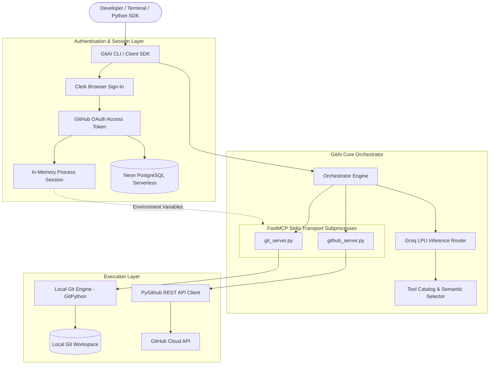

# GitAI: Agentic Natural Language Engine for Git & GitHub

GitAI translates natural language commands into Git and GitHub operations. Built on the Model Context Protocol (FastMCP) and accelerated by Groq LPU inference, GitAI provides an interactive CLI and an embeddable Python SDK with zero database configuration required by end users.

---

## Architecture Overview



---

## Core Subsystems

### 1. Natural Language Routing Engine
GitAI routes user queries to the appropriate tools without requiring local vector database infrastructure:
* **Tool Catalog**: A registry of 12 Git and GitHub actions defined using JSON schema specifications.
* **LLM Reasoning**: Queries are interpreted by Groq models (`openai/gpt-oss-120b` with automatic failover to `openai/gpt-oss-20b`, `qwen/qwen3.8-27b`, and `llama-3.1-8b-instant`).
* **Semantic Dispatch**: The orchestrator parses structured JSON decisions, validates argument types, and executes the designated tool via MCP clients.

### 2. FastMCP Tool Execution Subprocesses
Operations are isolated into dedicated FastMCP servers:
* **`git_server.py`**: Manages local repository state, staging, commits, branch management, merges, and filesystem interactions.
* **`github_server.py`**: Interacts with the GitHub REST API for creating repositories, managing issues, listing remotes, and repository cleanup.
* **Stdio Process Isolation**: Subprocesses run through `PythonStdioTransport`, receiving in-memory process credentials via environment mapping while operating independently of the main thread.

### 3. Multi-User Authentication Pipeline
* **OAuth Handshake**: Authentication is initiated locally on port `8787` using Clerk's browser interface.
* **Secure Token Delegation**: Upon completion, GitHub OAuth tokens are captured directly into process memory.
* **Zero Plaintext Files**: Tokens are never persisted to disk or plain configuration files. Tokens are stored in session memory and synchronized to Neon PostgreSQL.

### 4. Resilient Serverless Database Integration
User sessions, active states, and repository associations are backed by Neon PostgreSQL:
* **Connection Pooling**: SQLAlchemy poolers manage connection recycling and health pre-pings.
* **Direct IP Hostaddr Fallback**: The client includes automated host resolution and fallback to address local ISP and router DNS resolution failures.

---

## Request Lifecycle

1. **User Invocation**: The user enters a natural language query (e.g. `create repo backend at ./services`).
2. **Session Verification**: The session state is checked in process memory and verified against Neon PostgreSQL.
3. **Intent Normalization**: The orchestrator condenses conversational input into a standalone intent string.
4. **Tool Resolution**: Available tools are presented to the Groq model, which selects the target tool and structured parameters.
5. **MCP Dispatch**: The orchestrator sends the JSON-RPC call over standard input/output to the appropriate FastMCP server (`git_server` or `github_server`).
6. **Execution**: The server executes the action via GitPython or PyGithub and returns a structured response.
7. **Synthesis**: The output is formatted and displayed to the user via Rich markdown tables and logs.

---

## Installation

### From GitHub Repository
```bash
pip install git+https://github.com/SakshamBansal753/gitai.git
```

### From Local Source
```bash
git clone https://github.com/SakshamBansal753/gitai.git
cd gitai
pip install .
```

---

## Configuration

GitAI requires only a free Groq API key. Database and OAuth infrastructure are pre-configured.

### Setting your Groq API Key

Option A: Via CLI
```bash
gitai --set-groq-key gsk_your_api_key_here
```

Option B: Via Environment Variable
```bash
export GROQ_API_KEY="gsk_your_api_key_here"      # Linux / macOS
$env:GROQ_API_KEY="gsk_your_api_key_here"       # Windows PowerShell
```

---

## CLI Usage

### Interactive Shell
Launch the interactive session:
```bash
gitai
```
*(Alternative syntax if Scripts directory is not in system PATH: `python -m gitai`)*

### One-Shot Execution
Execute individual instructions directly:
```bash
gitai "create repo payment at ./gitflow"
gitai "create file README.md with content # Payment Service"
gitai "show my repos"
```

### Management Commands
```bash
gitai --whoami       # Inspect active authenticated database session
gitai --relogin      # Switch GitHub accounts
gitai --version      # Print installed version
gitai --help         # Show available flags
```

---

## Python SDK Reference

GitAI can be embedded directly into custom Python applications and automated scripts:

```python
import gitai

# Initializes using GROQ_API_KEY from environment or ~/.gitai/config.json
client = gitai.Client()

# Execute operations synchronously
result = client.run("create repo service-auth at ./microservices")
print(result["response"])

# Stage, commit, and push
res_commit = client.run("add all files and commit with message 'Initial release'")
print(res_commit["response"])

# Query repositories
res_repos = client.run("show my repos")
print(res_repos["response"])
```

### Asynchronous Execution
```python
import asyncio
import gitai

async def main():
    client = gitai.Client()
    result = await client.arun("get status of repo payment")
    print(result["response"])

asyncio.run(main())
```

---

## Tool Capabilities Matrix

| Tool | MCP Server | Description | Example Query |
| :--- | :--- | :--- | :--- |
| `create_repo` | `github_server` | Creates remote GitHub repository and clones locally | `"create repo analytics at ./projects"` |
| `list_my_repos` | `github_server` | Lists repositories for the signed-in user | `"show my repos"` |
| `search_repo` | `github_server` | Searches public repositories on GitHub | `"search github for fastmcp"` |
| `create_issue` | `github_server` | Opens an issue in a designated repository | `"create issue in payment titled Bug with login"` |
| `delete_repo` | `github_server` | Deletes a remote GitHub repository | `"delete repo test-repo with confirm true"` |
| `clone_repository`| `git_server` | Clones a repository by name or URL | `"clone repo payment to ./apps"` |
| `create_file` | `git_server` | Writes or updates files in a local repository | `"create file index.js with content console.log('hello')"` |
| `add_files_to_branch` | `git_server` | Stages modified files and creates commits | `"add files to branch main with commit 'Update docs'"` |
| `get_repo_status` | `git_server` | Reports git branch, modified, and untracked files | `"git status"` / `"is working tree clean"` |
| `get_branches` | `git_server` | Lists local and remote git branches | `"show all branches for repo payment"` |
| `merge_branch` | `git_server` | Merges one branch into another | `"merge feature into main"` |
| `search_user_repo`| `github_server` | Searches inside user repositories | `"find repositories matching docs"` |

---

## Security Model

1. **No Disk Tokens**: GitAI does not store OAuth tokens or GitHub keys in flat files (`.json`, `.txt`) on disk.
2. **Ephemeral Process Environment**: Credentials live in process memory during active CLI sessions and are shared with child MCP workers via isolated standard IO handles.
3. **Database Safeguards**: Tokens saved to the central Neon database allow cross-session retrieval while keeping the local client lightweight and stateless.
4. **Encrypted Transport**: All communication with Groq, Clerk, Neon PostgreSQL, and GitHub APIs occurs exclusively over TLS 1.3 / HTTPS.

---

## License

This project is licensed under the MIT License.
